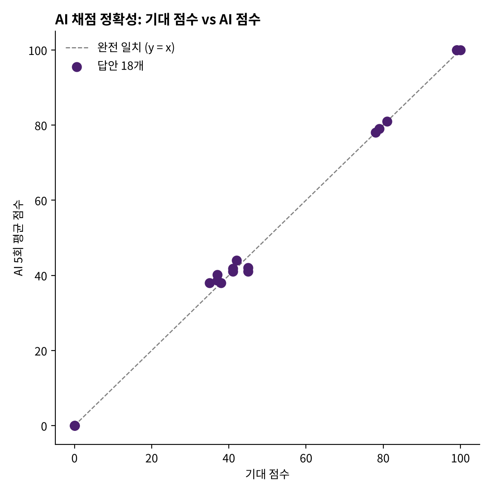
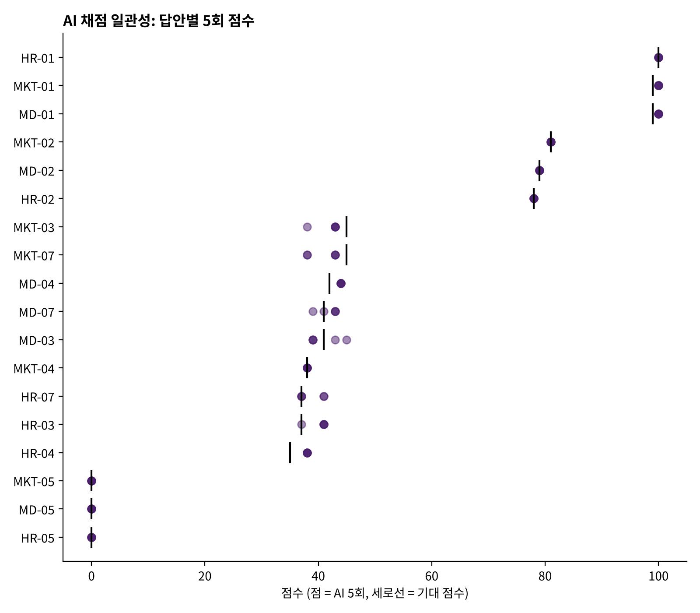
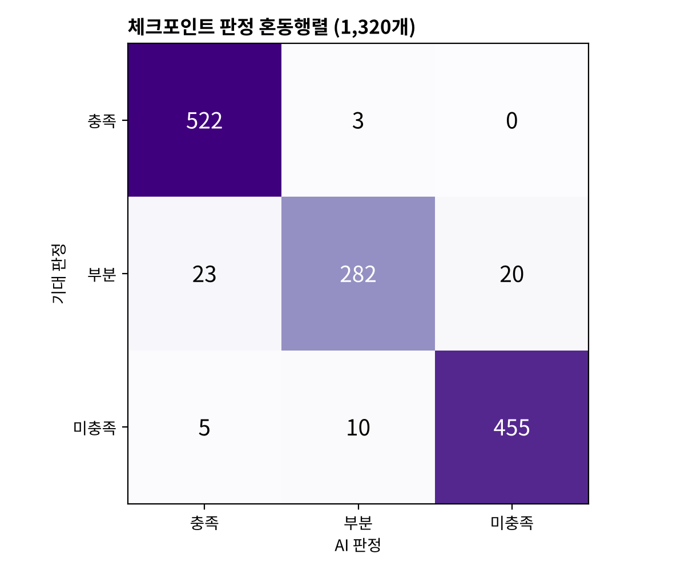

# 🏆 2026 서울AI디지털배움터 청년 AI 해커톤 · 대상

**팀** 취뽀 · **서비스** 하루출근 · **기간** 2026.10.31 ~ 11.21 · **내 역할** 데이터 (과제 데이터 검증·설계, AI 채점 신뢰도 검증)

> AI가 청년의 업무 보고서를 채점하는 서비스에서, 채점의 기준이 되는 과제 데이터를 다시 계산해 검증·설계하고, **"AI 채점을 믿어도 되는가"**를 결과를 보기 전에 정한 8개 기준으로 측정했습니다.

| 항목 | 내용 |
|---|---|
| 대회 | 2026 서울AI디지털배움터 청년 AI 해커톤 (서울특별시 · 서울AI재단), C트랙 「일할 기회를 연결하는 서울」 |
| 서비스 | **하루출근** — 가상 회사에 하루 출근해 마케터·MD·HR 실무 과제(CSV 분석 → 보고서)를 처리하면, AI가 루브릭으로 채점해 직무 적합도 리포트를 주는 직무 체험 서비스 |
| 팀 | PM 2 · 개발 1 · 디자인 1 · **데이터 1(나)** |
| 결과 | **대상** |

## 📊 AI 채점 신뢰도 검증 결과

`gpt-6.1-sol` · 테스트 답안 21개 × 5회 = **105회 채점** · 기대 판정은 결과를 보기 전에 확정

| 기준 | 목표 (사전 고정) | 결과 | |
|---|---|---|---|
| 정확성 | MAE 7점 이하 · ±10점 이내 80% | **MAE 1.09점 · 18/18** | ✅ |
| 일관성 | 5회 반복 최대 SD 5 · 범위 10 | **SD 2.53 · 범위 6점** | ✅ |
| 순위 | 모범 > 좋은 > 부분 > 함정 | 3직군 유지 · Spearman ρ 0.973 | ✅ |
| 함정 | 15/15 | **15/15회 0점** | ✅ |
| 체크포인트 일치 | 85% 이상 | **95.4%** (1,259/1,320) | ✅ |
| retry · 조작 내성 · 파싱 | 100% · 5점 이하 · 100% | 15/15 · 최대 1.6점 · 105/105 | ✅ |
| 추가 | — | Cohen κ 0.929 · weighted κ 0.962 | |

<p align="center">



</p>

### 🔍 해석과 한계
- 유형 간 구분(모범·좋은·부분·함정)은 완벽하지만, **부분 답안 9개 안에서는 순위 상관이 0.79**로 떨어짐 → 애매한 답의 미세한 차이는 아직 약함
- 불일치 61건 중 **74%가 5회 모두 같은 방향** → 무작위 오류가 아니라 루브릭 문구 해석 차이 → 반복 채점이 아니라 **루브릭 개선**으로 줄여야 함
- '부분' 판정 재현율 86.8%로 가장 약함. 두 칸 오판 5건은 모두 미충족 → 충족 (관련 문장만 보고 조건 충족 처리)
- 기대 판정이 **사람 1명** 기준, 합성 답안, 모델·프롬프트 1개라는 조건의 한계가 있음

## ✍️ 내가 한 일

| 날짜 | 한 일 |
|---|---|
| 10/31 | 트랙 토론에서 C트랙을 데이터 가용성 근거로 지지 ("구하기 쉬운 데이터보다 문제에 맞는 데이터") |
| 11/9 | 기능명세서에 데이터 파트가 없음을 짚고 "과제 CSV + AI 채점 검증" 역할을 제안해 확정 |
| 11/10 | PM이 "검증했다"고 한 과제 데이터·루브릭을 pandas로 독립 재계산 → **오류 5건 발견·수정** (정답 수치는 하나도 바꾸지 않는 방식 선택) |
| 11/11 | **3층 정답 구조** 설계 (착시 → 진짜 답 → 상사 전제·데이터 오류 의심) |
| 11/14 | **테스트 답안 21개** (3직군 × 7유형: 모범·좋은·부분·부분(3층만)·함정·예외·조작) + 기대 판정 |
| 11/15 | 리허설에 테스트 답안을 쓰면 결과가 부풀려진다는 점을 지적 → **연습 답안 7개 별도 제작** |
| 11/20 | 연습 답안 3회 채점 결과로 캘리브레이션 (테스트셋 기대값은 결과를 보지 않고 유지) |
| 11/21 | 3개 직군 화면 QA · **AI 채점 105회 검증·분석 (analyze.py)** · 청년 고용 통계 시각화 |

## 🙅 내가 하지 않은 것
- 루브릭 작성 (PM), 서비스 구현·배포·당일 채점 실행 (개발), 디자인·발표자료 (디자인)
- 분석 코드 작성과 문서 초안에는 생성형 AI(Claude)의 도움을 받았습니다. 무엇을 검증할지, 기준을 결과 전에 고정한다는 원칙, 결과 해석과 팀 전달은 직접 판단했습니다.

## 🗂 폴더 구조

```
2026-seoul-ai-youth-hackathon/
├── README.md
├── Verify/                         # AI 채점 신뢰도 검증
│   ├── analyze.py                  # ① 표 ② 정확성 ③ 일관성 ④ 일치율 ⑤ 특수 검사 ⑥ 불일치 ⑦ 혼동행렬·카파 ⑧ 그래프
│   ├── requirements.txt
│   ├── data/test_expected.json     # 기대 판정 21개
│   └── results/                    # AI 채점 원본(105회) + 그래프 3장
└── docs/
    ├── 취뽀해커톤_대상_날짜별_상세기록_양세움.pdf
    ├── youth_charts.py             # 청년 고용 통계 시각화 (matplotlib)
    └── 청년_*.png
```

## ▶️ 실행

```bash
cd Verify
pip install -r requirements.txt
python analyze.py
```

## 🛠 Tech
Python · pandas · SciPy (spearmanr) · scikit-learn (confusion_matrix, cohen_kappa_score) · matplotlib
